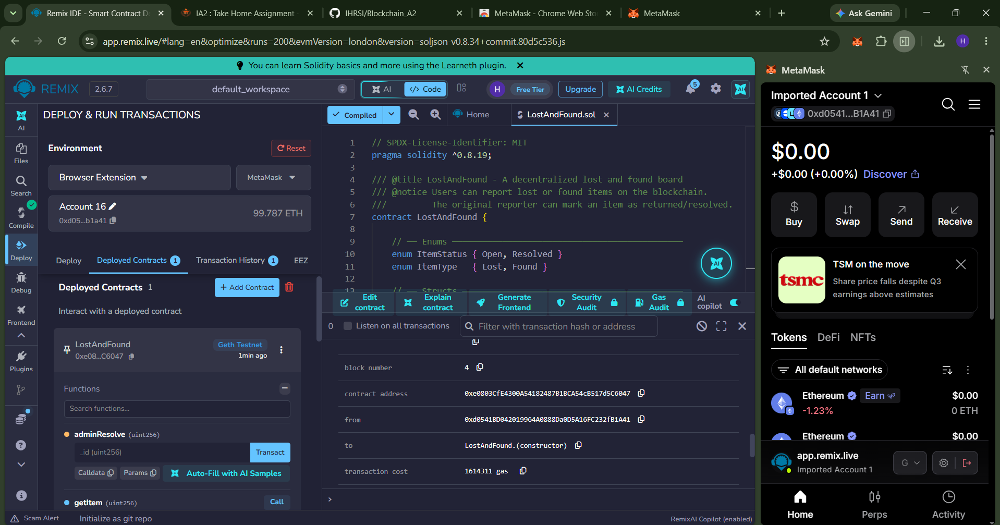
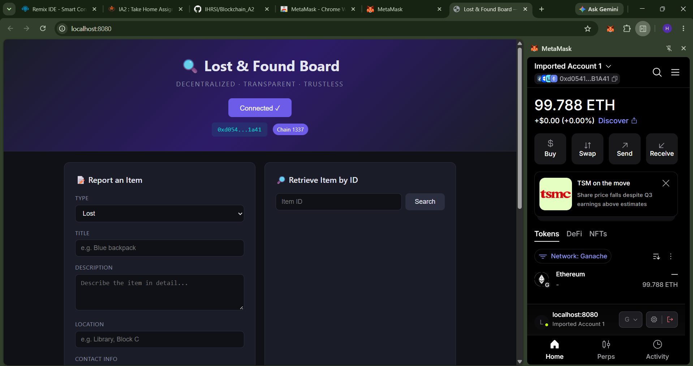
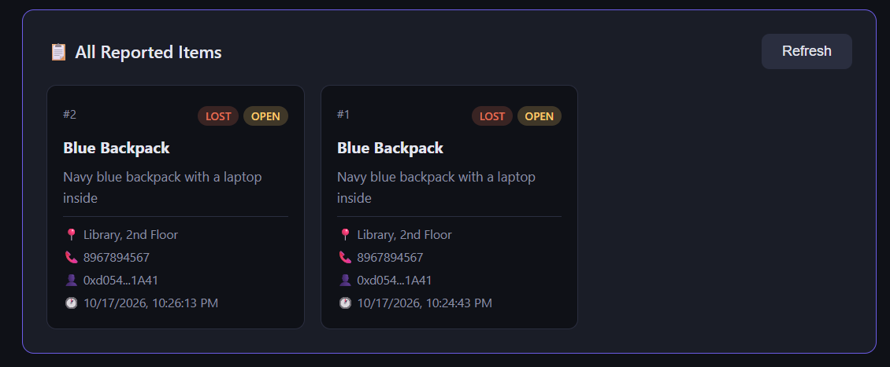
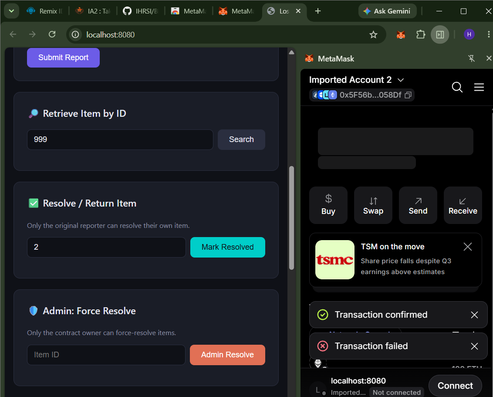
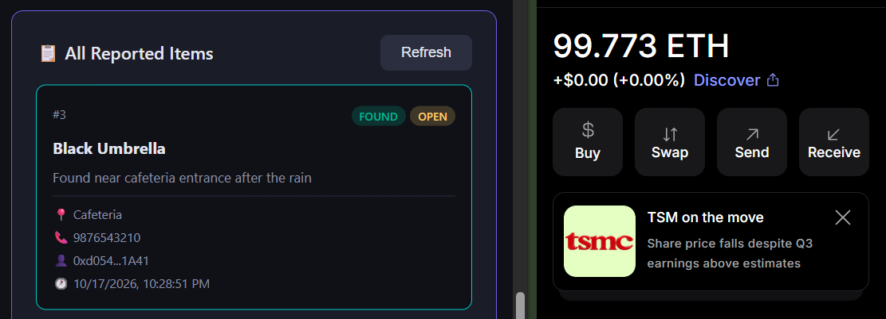
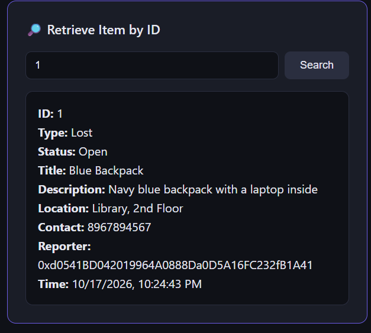

# 🔍 Lost & Found Board — Decentralized Application (DApp)

**Course:** Blockchain Technology (CSE4444) — Assignment 2  
**Student Name:** Hiten Raj Singh  
**Registration Number:** 230905152  
**DApp Title:** Lost & Found Board — A Decentralized Application on Ethereum  
**GitHub Repository:** [https://github.com/IHRSI/Blockchain_A2](https://github.com/IHRSI/Blockchain_A2)

---

## 📌 Problem Statement

Traditional lost and found systems (such as physical bulletin boards or social media groups) are centralized, disorganized, lack transparency, and can be tampered with or deleted. This DApp solves these problems by providing an immutable, publicly verifiable registry on the Ethereum blockchain:

- **Immutability:** Once reported, records cannot be altered or erased by third parties.
- **Transparency:** Anyone on the network can view and verify reports in real time.
- **Accountability & Access Control:** Only the original reporter has cryptographic authority to resolve their item.
- **Decentralization:** No single entity controls the data or application state.

---

## 🛠️ Technology Stack

| Component | Technology | Description |
|---|---|---|
| **Smart Contract** | Solidity (`^0.8.19`) | Core business logic, access control, events, data storage |
| **Development & Compilation** | Remix IDE | Compiler configured with EVM Version `london` |
| **Local Blockchain** | Ganache | Local Ethereum test network (Chain ID: `1337` / RPC: `7545`) |
| **Frontend** | HTML5, CSS3, JavaScript (ES6) | Responsive dark-mode interface with zero external CSS frameworks |
| **Web3 Library** | Ethers.js (v5.7) | Wallet connection and contract interaction |
| **Crypto Wallet** | MetaMask | Key management and transaction signing |

---

## 📁 Repository Structure

```
├── contracts/
│   └── LostAndFound.sol                       # Solidity smart contract
├── frontend/
│   ├── index.html                             # User interface
│   ├── style.css                              # Custom responsive CSS design
│   └── app.js                                 # Web3 & Ethers.js integration logic
├── screenshots/                               # Supporting evidence and test results
│   ├── 01_compilation.png                     # Contract compilation in Remix
│   ├── 02_deployment.png                      # Contract deployment on Ganache
│   ├── 03_metamask_connection.png             # MetaMask wallet connection
│   ├── 04_successful_tx.png                   # Successful transaction
│   ├── 05_failed_tx.png                       # Rejected / unauthorized transaction
│   ├── 06_found_item.png                      # Reported item displayed in UI
│   └── 07_retrieve_item.png                   # Item data query by ID
├── Hiten Raj Singh_230905152_BT_Assignment2.docx # Assignment submission document
└── README.md                                  # Complete project documentation
```

---

## 🌐 Deployment Details

| Parameter | Value |
|---|---|
| **Network** | Ganache Local Ethereum Network |
| **RPC URL** | `http://127.0.0.1:7545` |
| **Chain ID** | `1337` |
| **Contract Address** | `0xe0803CfE4300A54182487B1BCA54cB517d5C6047` |
| **Compiler Version** | Solidity `0.8.19` |
| **EVM Target** | `london` |
| **Deployer Account** | `0xd054...b1a41` (Account 16 / Imported Account 1) |

---

## 🚀 Steps to Run and Execute the Application

### 1. Set Up Ganache
1. Download and start **Ganache**.
2. Select **Quickstart Ethereum**.
3. Note the RPC Server address (`HTTP://127.0.0.1:7545`) and Chain ID (`1337`).
4. Copy the private key of the first account to import into MetaMask.

### 2. Configure MetaMask
1. Open the MetaMask browser extension.
2. Add a new manual network:
   - **Network Name:** `Ganache Local`
   - **New RPC URL:** `http://127.0.0.1:7545`
   - **Chain ID:** `1337`
   - **Currency Symbol:** `ETH`
3. Switch MetaMask to the **Ganache Local** network.
4. Import the private key from Ganache (gives ~100 test ETH).
5. Import a second account to test unauthorized calls.

### 3. Compile & Deploy via Remix IDE
1. Open [Remix IDE](https://remix.ethereum.org/).
2. Create `contracts/LostAndFound.sol` and paste the smart contract code.
3. Under **Solidity Compiler**:
   - Compiler version: `0.8.19`
   - Advanced Configurations > EVM Version: `london`
   - Click **Compile LostAndFound.sol**.
4. Under **Deploy & Run Transactions**:
   - Environment: `Browser Extension` (MetaMask).
   - Click **Deploy** and confirm the transaction in MetaMask.
   - Note the deployed contract address: `0xe0803CfE4300A54182487B1BCA54cB517d5C6047`.

### 4. Configure Contract Address
In `frontend/app.js`, line 7 is configured with:
```javascript
const CONTRACT_ADDRESS = "0xe0803CfE4300A54182487B1BCA54cB517d5C6047";
```

### 5. Launch the Frontend
Serve the frontend over a local web server (MetaMask requires HTTP/HTTPS origin and blocks direct `file:///` execution):
```bash
npx http-server ./frontend -p 8080
```
Open **`http://localhost:8080`** in your browser where MetaMask is installed.

---

## 🔗 Interacting with the Smart Contract

1. **Connect Wallet:** Click **Connect MetaMask** in the header. MetaMask prompts for connection and displays your address and network badge.
2. **Report Lost / Found Item:** Fill in item type, title, description, location, and contact information. Click **Submit Report** and confirm the transaction via MetaMask.
3. **Query Blockchain Data:** Enter an Item ID in the **Retrieve Item by ID** box and click **Search** to read the record directly from the contract.
4. **Resolve Item:** The original reporter enters the Item ID and clicks **Mark Resolved**. Status updates to `Resolved` on the blockchain.
5. **Admin Force-Resolve:** The contract owner can force-resolve flagged or obsolete items via `adminResolve`.
6. **Refresh Items:** Click **Refresh** to load all active and resolved items onto the board.

---

## 🧪 Comprehensive Test Cases & Results

| # | Test Scenario | Input Data | Expected Result | Observed Result | Status |
|---|---|---|---|---|:---:|
| **1** | **Valid Input:** Report Lost Item | Type: Lost<br>Title: `Blue Backpack`<br>Location: `Library, 2nd Floor` | Transaction executes, event emitted, item saved with status `Open`. | Block mined, UI updates with new item. | ✅ **Pass** |
| **2** | **Valid Input:** Report Found Item | Type: Found<br>Title: `Black Umbrella`<br>Location: `Cafeteria, Block A` | Item stored with type `Found` on blockchain. | Item appears on board with `Found` badge. | ✅ **Pass** |
| **3** | **Valid Input:** Resolve Own Item | Caller: Reporter (Account A)<br>Item ID: `1` | Status changed from `Open` to `Resolved`. | Status tag switches to `Resolved`. | ✅ **Pass** |
| **4** | **Invalid Input:** Empty Title | Title: `""` (Empty string) | Contract reverts: `"Title must be 1-100 characters"`. | Client validation and contract reject transaction. | ✅ **Pass** |
| **5** | **Invalid Input:** Description Too Long | Description > 500 characters | Contract reverts: `"Description must be 1-500 characters"`. | Rejected prior to state change. | ✅ **Pass** |
| **6** | **Invalid Input:** Non-Existent Item ID | Query Item ID: `999` | Contract reverts: `"Item does not exist"`. | Revert error displayed in status bar. | ✅ **Pass** |
| **7** | **Unauthorized:** Resolve Another User's Item | Caller: Account B (Non-reporter)<br>Item ID: `1` (Created by Account A) | Reverts: `"Only the original reporter can do this"`. | Transaction fails and MetaMask warns/reverts. | ✅ **Pass** |
| **8** | **Unauthorized:** Non-Owner Admin Resolve | Caller: Account B (Non-owner)<br>Calling: `adminResolve(1)` | Reverts: `"Only contract owner can call this"`. | Revert verified; unauthorized user denied. | ✅ **Pass** |
| **9** | **Invalid State:** Resolve Already Resolved Item | Item ID: `1` (Already resolved) | Reverts: `"Item is already resolved"`. | Error caught; double-resolution prevented. | ✅ **Pass** |

---

## 📸 Evidence & Screenshots

### 1. Smart Contract Compilation
Successful compilation in Remix IDE using Solidity compiler `0.8.19` with EVM version `london`:


---

### 2. Smart Contract Deployment
Contract deployed to Ganache via MetaMask (`Injected Provider / Browser Extension`):


---

### 3. MetaMask Wallet Connection
MetaMask wallet connected to the Lost & Found Board DApp:


---

### 4. Successful Blockchain Transaction
Successful transaction execution confirming item registration on Ethereum:


---

### 5. Failed / Unauthorized Transaction
MetaMask and smart contract rejecting unauthorized transaction:


---

### 6. Blockchain Data Displayed on Frontend
Display of reported items with metadata, status badges, reporter addresses, and timestamps:


---

### 7. Blockchain Data Retrieval by ID
Direct on-chain retrieval and display of individual item records:


---

## 🔒 Security & Privacy Notice
- No real private keys, passwords, or seed phrases are used or stored in this repository.
- All credentials shown correspond to throwaway local Ganache test environments.
