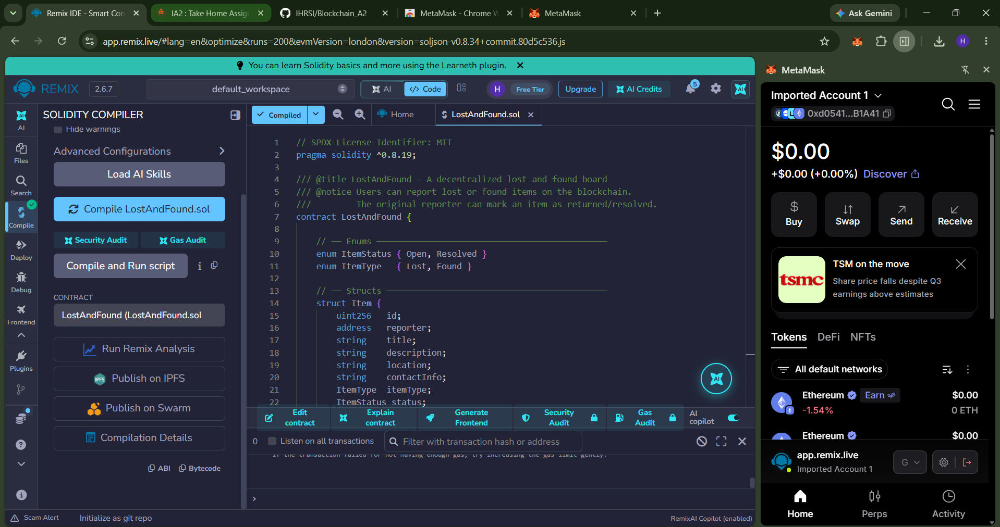

# 🔍 Lost & Found Board — Decentralized Application (DApp)

A simple, transparent, and decentralized **Lost & Found Board** built on the Ethereum blockchain. Users can report lost or found items on-chain, and mark them as returned/resolved. All records are immutable and publicly verifiable.

---

## 📌 Problem Statement

Traditional lost and found systems (bulletin boards, social media groups) are centralized, lack transparency, and can be tampered with. This DApp solves these issues by storing all reports on the Ethereum blockchain, ensuring:

- **Immutability** — Records cannot be altered or deleted
- **Transparency** — Anyone can verify reports
- **Accountability** — Only the original reporter can resolve their own item
- **Decentralization** — No single authority controls the data

---

## 🛠️ Tech Stack

| Component       | Technology                        |
|-----------------|-----------------------------------|
| Smart Contract  | Solidity ^0.8.19                  |
| IDE             | Remix IDE                         |
| Local Blockchain| Ganache                           |
| Frontend        | HTML, CSS, JavaScript             |
| Blockchain Lib  | Ethers.js v5.7                    |
| Wallet          | MetaMask                          |

---

## 📁 Project Structure

```
├── contracts/
│   └── LostAndFound.sol       # Solidity smart contract
├── frontend/
│   ├── index.html             # Frontend HTML
│   ├── style.css              # Stylesheet
│   └── app.js                 # JavaScript (Ethers.js + MetaMask)
├── Img/                       # Screenshots and evidence
│   ├── test-results01_compilation.png.png
│   ├── test-results02_deployment.png.png
│   ├── test-results03_metamask_connection.png.png
│   ├── test-results04_successful_tx.png.png
│   ├── test-results05_failed_tx.png.png
│   ├── Found.png
│   └── Retrive.png
└── README.md                  # This file
```

---

## 🚀 Steps to Execute the Application

### Step 1: Set Up Ganache (Local Blockchain)

1. Download and install [Ganache](https://trufflesuite.com/ganache/).
2. Launch Ganache and start a workspace (Quickstart Ethereum).
3. Note the **RPC Server URL** (default: `http://127.0.0.1:7545`).
4. Note any of the generated **account addresses** and **private keys**.

### Step 2: Add Ganache Network to MetaMask

1. Open MetaMask browser extension.
2. Click the network dropdown → **Add Network** → **Add a Network Manually**.
3. Enter:
   - **Network Name:** Ganache Local
   - **New RPC URL:** `http://127.0.0.1:7545`
   - **Chain ID:** `1337`
   - **Currency Symbol:** ETH
4. Click **Save** and switch to the Ganache Local network.
5. **Import an account**: Click your avatar → Import Account → Paste a private key from Ganache.

### Step 3: Compile & Deploy the Smart Contract (Remix IDE)

1. Open [Remix IDE](https://remix.ethereum.org/).
2. Create a new file `LostAndFound.sol` and paste the contents of `contracts/LostAndFound.sol`.
3. Go to the **Solidity Compiler** tab:
   - Select compiler version `0.8.19` (or compatible).
   - Under Advanced Configurations, set **EVM Version** to `london`.
   - Click **Compile LostAndFound.sol**.
4. Go to the **Deploy & Run Transactions** tab:
   - Set **Environment** to `Browser Extension` → select **MetaMask**.
   - Ensure the correct account is selected.
   - Click **Deploy** and confirm in MetaMask.
5. After deployment, copy the **deployed contract address** from Remix.

### Step 4: Configure the Frontend

1. Open `frontend/app.js`.
2. Replace the placeholder with your actual deployed contract address:
   ```javascript
   const CONTRACT_ADDRESS = "0xYourDeployedContractAddress";
   ```

### Step 5: Run the Frontend

1. Serve the frontend using a local HTTP server (e.g., `npx http-server ./frontend -p 8080`).
2. Open `http://localhost:8080` in the browser where MetaMask is installed.
3. Click **Connect MetaMask** to connect your wallet.
4. Start reporting items, searching, and resolving!

> **Note:** Do not open `index.html` directly as a file (`file://`). MetaMask requires the page to be served over HTTP.

---

## 🔗 Connecting MetaMask & Interacting with the Contract

1. **Connect**: Click the "Connect MetaMask" button in the header. MetaMask will prompt you to approve the connection.
2. **Report an Item**: Fill in the form (type, title, description, location, contact info) and click "Submit Report". Confirm the transaction in MetaMask.
3. **Search by ID**: Enter an item ID in the search section and click "Search" to view its details.
4. **Resolve Item**: Enter the item ID and click "Mark Resolved". Only the original reporter can resolve their item.
5. **Admin Resolve**: Only the contract deployer (owner) can use this to force-resolve any item (e.g., to remove spam).
6. **View All Items**: Click "Refresh" to load all items from the blockchain.

---

## 🌐 Deployment Details

| Detail                  | Value                                      |
|-------------------------|-------------------------------------------|
| **Network**             | Ganache Local                              |
| **RPC URL**             | `http://127.0.0.1:7545`                   |
| **Chain ID**            | `1337`                                     |
| **Contract Address**    | `0xe0803CfE4300A54182487B1BCA54cB517d5C6047` |
| **Compiler Version**    | Solidity ^0.8.19                           |
| **EVM Version**         | London                                     |
| **Deployer Account**    | `0xd054...b1a41`                           |

---

## 🧪 Test Cases

### Test 1: Valid Input — Report a Lost Item ✅

| Field       | Value                            |
|-------------|----------------------------------|
| Type        | Lost                             |
| Title       | Blue Backpack                    |
| Description | Navy blue Jansport with laptop   |
| Location    | Library, 2nd Floor               |
| Contact     | john@example.com                 |

**Expected:** Transaction succeeds. Item appears in the "All Reported Items" list.  
**Result:** ✅ Pass

---

### Test 2: Valid Input — Report a Found Item ✅

| Field       | Value                            |
|-------------|----------------------------------|
| Type        | Found                            |
| Title       | Black Umbrella                   |
| Description | Found near cafeteria entrance    |
| Location    | Cafeteria, Block A               |
| Contact     | 9876543210                       |

**Expected:** Transaction succeeds.  
**Result:** ✅ Pass


---

### Test 3: Valid Input — Resolve Own Item ✅

- Report an item from Account A.
- Use Account A to call `resolveItem(1)`.

**Expected:** Item status changes to "Resolved".  
**Result:** ✅ Pass

---

### Test 4: Invalid Input — Empty Title ❌

| Field       | Value                            |
|-------------|----------------------------------|
| Title       | *(empty)*                        |

**Expected:** Transaction reverts with "Title must be 1-100 characters".  
**Result:** ✅ Correctly rejected (client-side and contract-level validation).

---

### Test 5: Invalid Input — Description Too Long ❌

| Field       | Value                            |
|-------------|----------------------------------|
| Description | *(501+ characters)*              |

**Expected:** Transaction reverts with "Description must be 1-500 characters".  
**Result:** ✅ Correctly rejected.

---

### Test 6: Invalid Input — Non-Existent Item ID ❌

- Call `getItem(999)` when only 2 items exist.

**Expected:** Transaction reverts with "Item does not exist".  
**Result:** ✅ Correctly rejected.

---

### Test 7: Unauthorised — Resolve Someone Else's Item ❌

- Report an item from Account A.
- Switch to Account B in MetaMask.
- Try to call `resolveItem(1)` from Account B.

**Expected:** Transaction reverts with "Only the original reporter can do this".  
**Result:** ✅ Correctly rejected.

---

### Test 8: Unauthorised — Non-Owner Calls Admin Resolve ❌

- Switch to a non-owner account.
- Try to call `adminResolve(1)`.

**Expected:** Transaction reverts with "Only contract owner can call this".  
**Result:** ✅ Correctly rejected.

---

### Test 9: Invalid — Resolve an Already Resolved Item ❌

- Resolve item #1 successfully.
- Try resolving item #1 again.

**Expected:** Transaction reverts with "Item is already resolved".  
**Result:** ✅ Correctly rejected.

---

## 📸 Screenshots

### 1. Smart Contract Compilation


### 2. Smart Contract Deployment


### 3. MetaMask Wallet Connection


### 4. Successful Transaction (Report Item)


### 5. Failed Transaction (Unauthorised Resolve)


### 6. Blockchain Data Displayed — Found Item


### 7. Blockchain Data Retrieved — Item Search


---

## ⚠️ Important Notes

- **No private keys or seed phrases** are included in this repository.
- The contract was tested on a **local Ganache** blockchain.
- To test on a public testnet (e.g., Sepolia), get test ETH from a [faucet](https://sepoliafaucet.com/) and update the network in MetaMask.

---

## 📝 License

This project is developed for academic purposes as part of **CSE4444 — Blockchain Technology, Assignment 2**.
